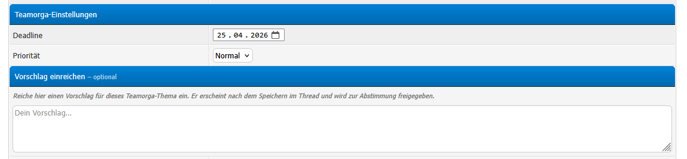
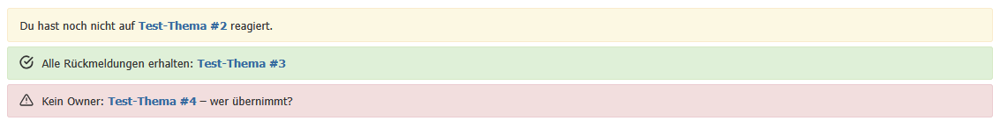
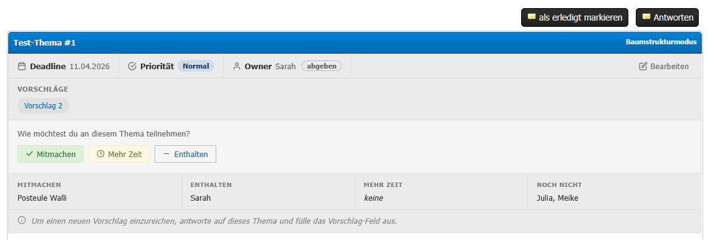
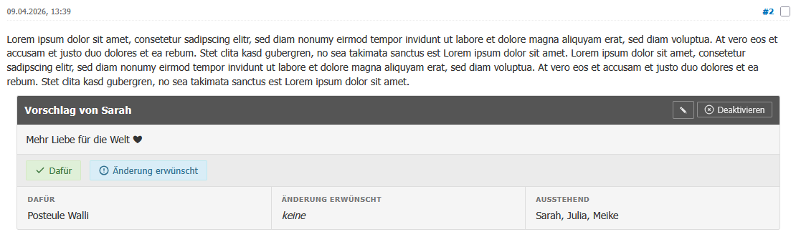

# Teamorga

**Version 1.2.0** – Team organisation plugin for MyBB 1.8

Teamorga helps teams coordinate decisions in the forum. Threads can be marked as "Teamorga topics" with a deadline and priority. Team members register their participation, submit suggestions (via replies), and vote on them. The forum index shows reminders for open items.

---

## Requirements

- MyBB 1.8.x
- PHP 7.4 or higher
- No dependencies on other plugins

---

## Installation

1. Upload all files from `inc/` to your MyBB root `inc/` directory.
2. Go to **Admin CP → Configuration → Plugins** and activate **Teamorga**.
3. Go to **Admin CP → Configuration → Settings → Teamorga** and configure the plugin.

---

## Configuration

| Setting | Description |
|---|---|
| **Enabled** | Enable or disable the plugin globally. |
| **Forums** | Which forums the plugin applies to. |
| **Groups** | Which user groups can use Teamorga. Set to `-1` for all groups. |
| **Editor Groups** | Which groups may edit any suggestion (not just their own). |
| **Default Deadline (days)** | Pre-filled deadline offset when creating a new topic. |
| **Reminder Lead (days)** | How many days before deadline a reminder appears on the index. |
| **Team Account ID** | UID of a shared team account that can create topics but is not counted as a voter. |

---

## Usage

### First steps after activation

1. Go to Settings → Teamorga and select the forums and groups.
2. Create a new thread in one of the configured forums – the Teamorga fields (deadline, priority) will appear in the posting form.

### Core workflow

#### Creating a Teamorga topic

1. Go to the configured forum and click **New Thread**.
2. Fill in the usual thread subject and message.
3. Fill in the **Teamorga fields** below: deadline date and priority.
4. Post the thread – all group members are automatically added as participants.

#### Adding an existing thread to Teamorga

1. Open any thread in a configured forum.
2. If you are in an editor group, a button **+ Add to Teamorga** appears above the posts.
3. Click it, fill in deadline and priority, and save.

#### Participation (topic level)

The Teamorga panel shown above the posts lets members indicate their participation:

- **Mitmachen** – I am participating.
- **Enthalten** – I abstain.
- **Mehr Zeit** – I need more time.

The panel also shows which members have confirmed, abstained, or not yet responded.

#### Forum topic list

In the forum thread list, each Teamorga topic shows a compact badge with:

- A **status dot** on the left indicating your personal participation status (colour-coded).
- A **coloured priority stripe** and **priority label** matching the configured priority (Low / Normal / Medium / High / Inactive).
- A **deadline date** with an overdue indicator when the deadline has passed.
- A **CTA banner** if your participation or suggestion vote is still pending.

Inactive topics are treated as done and show no pending CTA.

#### Submitting suggestions

1. Click **Reply** in the Teamorga thread.
2. Fill in the **suggestion field** that appears above the reply form.
3. Post the reply – a voting block appears directly on your post.

#### Voting on suggestions

Each post with a suggestion shows voting buttons for all active participants:

- **✓ Dafür** – vote in favour.
- **✗ Dagegen** – vote against.
- Withdraw your vote at any time.

Suggestion owners and editor-group members can edit the suggestion text or toggle it active/inactive.

#### Ownership

Anyone can claim or give up ownership of a topic in the Teamorga panel. The owner receives an index notification once all votes are in.

#### Index reminders

The forum index shows alerts for:

- Topics you have not responded to yet.
- Suggestions waiting for your review.
- Upcoming deadlines (within the configured lead time).
- Topics with all votes collected (for the owner).
- Active topics without an owner (for editor groups).

---

## Uninstallation

1. Go to **Admin CP → Configuration → Plugins** and deactivate **Teamorga**.
2. Click **Uninstall** to remove all database tables and settings.

> **Note:** Uninstalling removes all Teamorga data permanently.

---

## Screenshots

---

## Changelog

See [CHANGELOG.md](CHANGELOG.md) for the full version history.
